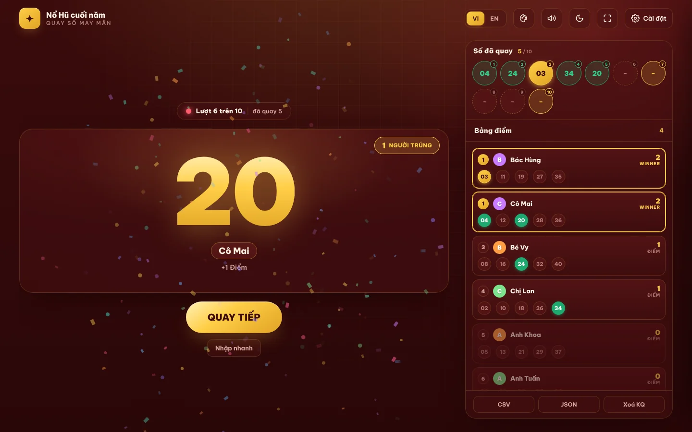
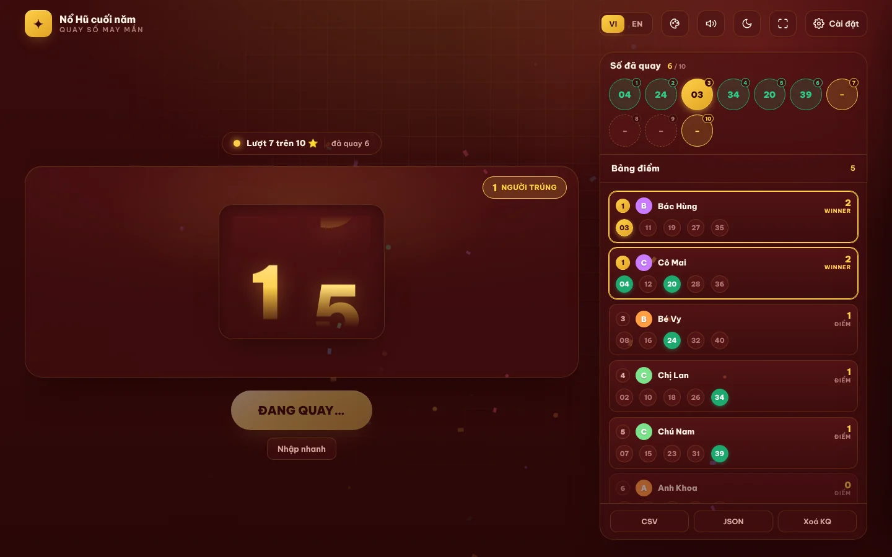
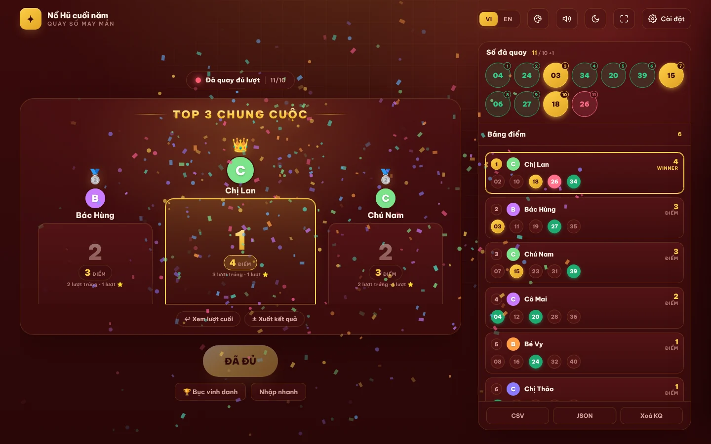
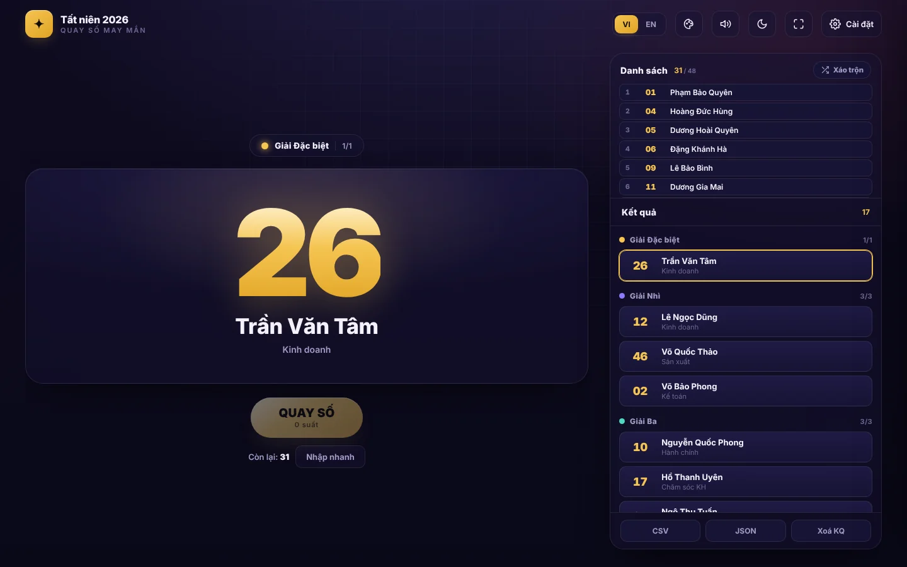
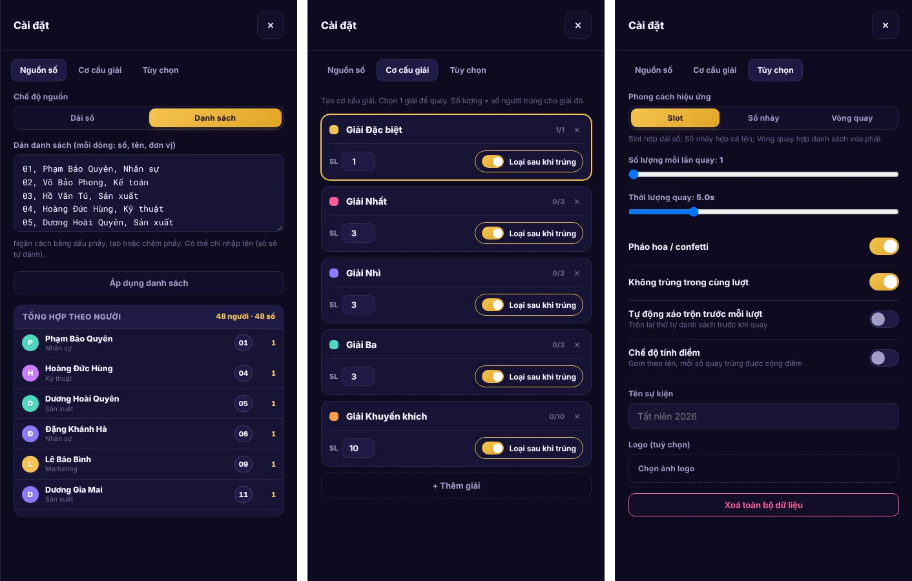
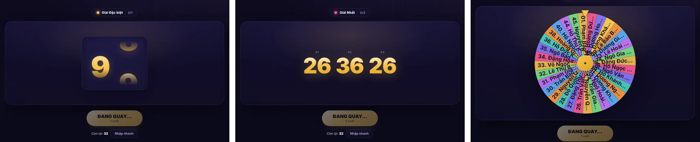
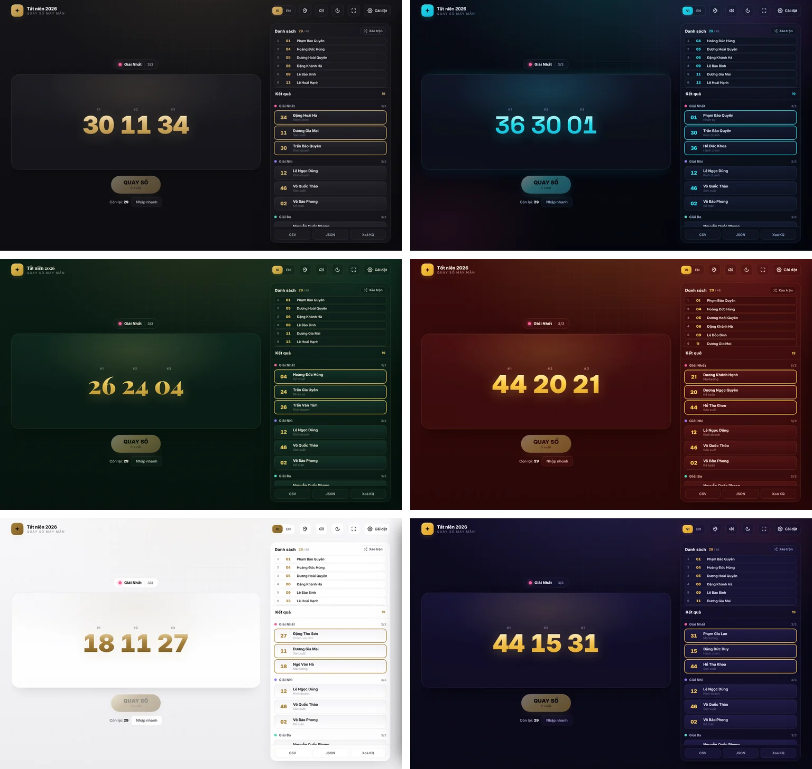
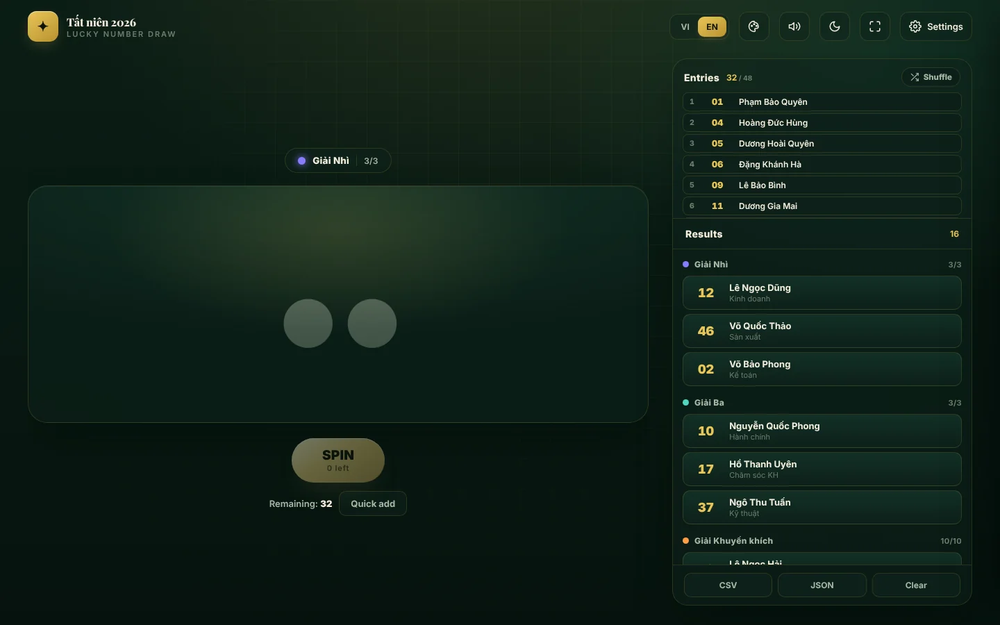
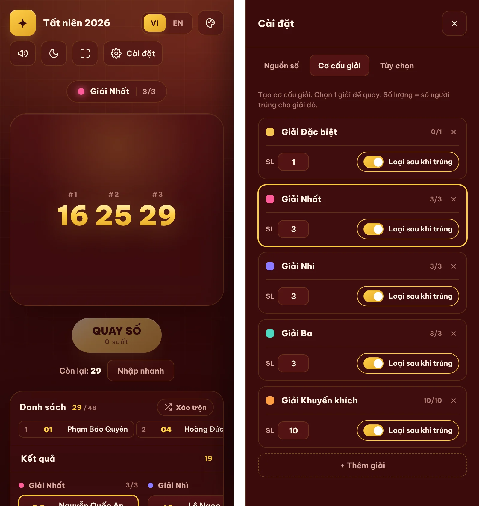

<h1 align="center">✦ PaNIC Lucky Draw</h1>

  Nổ hũ số may mắn: mỗi người giữ vài con số, quay trúng số nào người đó được cộng điểm, lượt ⭐ may mắn được cộng nhiều điểm hơn. 
  Ai nhiều điểm nhất lên bục vinh danh. Quay thưởng theo cơ cấu giải cũng có đủ cho tiệc tất niên, sự kiện, đám cưới.

  <a href="https://panic-lucky-draw.vercel.app/"><b>Mở website →</b></a>
  &nbsp;·&nbsp; Miễn phí &nbsp;·&nbsp; Không cần tài khoản &nbsp;·&nbsp; Dùng được cả khi không có mạng

---

## Dành cho ai?

Cho người tổ chức sự kiện cần một màn quay số **đẹp, công bằng và dễ điều khiển**: MC chỉ cần bấm một nút (hoặc phím `Space`), con số hiện to giữa màn hình, tên người trúng hiện ngay bên dưới, điểm và kết quả tự ghi lại.

Có hai cách chơi:
- **Nổ hũ số may mắn** (chế độ chính): cả hội cùng đua điểm qua nhiều lượt quay, kịch tính tới lượt cuối.
- **Quay thưởng theo giải**: bốc thăm lần lượt Giải Đặc biệt, Nhất, Nhì, Ba, Khuyến khích.

## Mục lục

- [Nổ hũ số may mắn](#nổ-hũ-số-may-mắn)
- [Quay thưởng theo giải](#quay-thưởng-theo-giải)
- [Ba kiểu hiệu ứng quay](#ba-kiểu-hiệu-ứng-quay)
- [Năm giao diện, sáng và tối](#năm-giao-diện-sáng-và-tối)
- [Bảng kết quả và xuất file](#bảng-kết-quả-và-xuất-file)
- [Tên sự kiện, logo, song ngữ](#tên-sự-kiện-logo-song-ngữ)
- [Trên điện thoại và máy tính bảng](#trên-điện-thoại-và-máy-tính-bảng)

---

## Nổ hũ số may mắn

Đây là chế độ chính của Lucky Draw. Mỗi người giữ nhiều số, mỗi lần quay trúng số của ai thì người đó được cộng điểm, ai nhiều điểm nhất sau tất cả các lượt sẽ thắng. Bật trong **Cài đặt → Tùy chọn → Chế độ tính điểm**.

- Chọn **tổng số lượt quay**, và quay trong các số đã có người giữ hoặc trong cả dải số.
- **Vị trí may mắn** ⭐: một số lượt được cộng nhiều điểm hơn. Bạn tự chỉ định trước (ví dụ lượt 3, 7, 10) hoặc để hệ thống bốc ngẫu nhiên và giấu kín tới đúng lượt đó.
- **Bảng điểm** cập nhật sau mỗi lượt. Nếu có người đồng hạng nhất, game tự mở lượt **quay phụ** để phân định.
- Kết thúc là **bục vinh danh Top 3**, có nút xem lại lượt cuối và xuất kết quả.

## Quay thưởng theo giải

### Quay theo dải số hoặc theo danh sách

- **Dải số**: chọn từ số nào đến số nào (ví dụ 1 đến 300 theo số phiếu bốc thăm), có thể thêm số 0 đứng đầu cho đẹp: 01, 02, 099…
- **Danh sách**: dán danh sách từ Excel, mỗi dòng gồm số, tên và đơn vị. Chỉ có tên cũng được, số sẽ tự đánh. Mục **Tổng hợp theo người** cho biết mỗi người đang giữ những số nào.

Có thể **xáo trộn** danh sách, hoặc bật **tự động xáo trộn trước mỗi lượt**.

### Cơ cấu giải

Tạo bao nhiêu giải tuỳ ý, mỗi giải có tên, màu và số lượng người trúng riêng (mặc định: Đặc biệt, Nhất, Nhì, Ba, Khuyến khích). Chọn **Loại sau khi trúng** để một người không trúng hai lần. Chọn giải cần quay ngay trong danh sách này (bấm vào tên giải phía trên khung quay là mở nhanh). Bộ đếm `0/3` cho biết giải đó đã quay được bao nhiêu suất.

Nguồn số · Cơ cấu giải · Tùy chọn

## Ba kiểu hiệu ứng quay

- **Slot**: từng chữ số lăn như máy đánh bạc, hợp nhất với dải số.
- **Số nhảy**: các con số nhảy liên tục rồi dừng lại, hợp cả số lẫn tên.
- **Vòng quay**: vòng quay may mắn với tên từng người, hợp với danh sách vừa phải.

Chọn **quay nhiều người một lần** (tới 15 người cho giải Khuyến khích), chỉnh **thời lượng quay** từ 2 tới 15 giây, bật pháo hoa và âm thanh cho thêm phần kịch tính.

Slot · Số nhảy (3 người một lần) · Vòng quay

## Năm giao diện, sáng và tối

Đổi giao diện ngay trong lúc chạy cho hợp với không khí sự kiện:

| Giao diện | Phong cách |
|---|---|
| **Aurora** | Midnight Gala, tím và vàng |
| **Platinum** | Tối giản, sang trọng |
| **Neon Glass** | Cyber, kính mờ |
| **Royal Gala** | Lục bảo và vàng gold |
| **Festive Tết** | Đỏ và vàng lễ hội |

Mỗi giao diện đều có bản **sáng** và **tối**. Bấm nút toàn màn hình (hoặc phím `F`) khi chiếu lên máy chiếu.

Platinum · Neon Glass · Royal Gala · Festive Tết · Platinum (sáng) · Aurora

## Bảng kết quả và xuất file

Mọi người trúng được ghi lại theo từng giải ở bảng bên cạnh, kèm số, tên và đơn vị. Bấm **CSV** để mở bằng Excel hoặc **JSON** để lưu trữ. Mọi thứ được tự lưu, lỡ tải lại trang hay tắt máy cũng không mất kết quả.

## Tên sự kiện, logo, song ngữ

Đặt **tên sự kiện** (ví dụ *Tất niên 2026*) và tải **logo** của công ty lên để hiện ở góc màn hình. Chuyển **VI / EN** bất cứ lúc nào, toàn bộ giao diện đổi theo.

## Trên điện thoại và máy tính bảng

Khung quay nằm trên, danh sách và kết quả xếp bên dưới, vuốt ngang để xem từng giải. Tiện để MC cầm điều khiển, hoặc để thử trước khi lên sân khấu.

---

## Bắt đầu trong ba bước

1. Mở **Cài đặt → Nguồn số**, dán danh sách: mỗi dòng một số và tên người giữ số đó (một người giữ nhiều số thì ghi nhiều dòng).
2. Vào **Tùy chọn**, bật **Chế độ tính điểm**, chọn tổng số lượt quay và các vị trí may mắn ⭐.
3. Bấm **QUAY SỐ** hoặc nhấn `Space`, quay đủ lượt là bục vinh danh hiện ra.

Muốn quay thưởng theo giải thì bỏ qua bước 2 và chỉnh giải ở tab **Cơ cấu giải**.

## Phím tắt

| Phím | Tác dụng |
|---|---|
| `Space` | Quay số |
| `F` | Toàn màn hình |

## Lưu ý

Danh sách, cơ cấu giải và kết quả chỉ được lưu trên trình duyệt của máy đang dùng. Muốn bắt đầu sự kiện mới, vào **Tùy chọn → Xoá toàn bộ dữ liệu**. Nhớ xuất **CSV** trước khi xoá nếu cần giữ kết quả.

Made with ❤️ by <a href="https://github.com/mdev-qn95">mdev-qn95</a>

